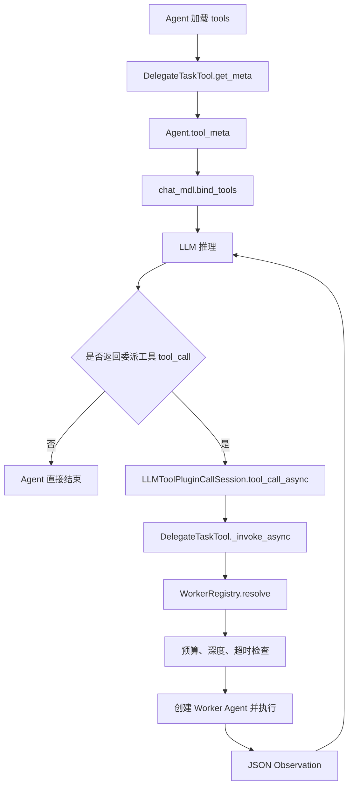

# RAGFlow Python Canvas 多 Agent 委派与协作

## 1. 目标与边界

本功能在 RAGFlow 现有 Python Canvas 链路上增加动态委派、固定团队流程和四种协作策略。实现复用现有组件生命周期、Agent ReAct 工具循环、Canvas 变量、取消、模型解析和日志能力，不引入第二套 Agent 执行器。

支持的处理方式：

| 方式 | 控制主体 | 执行形态 | 适用场景 |
| --- | --- | --- | --- |
| 点对点 `DelegateTask` | 当前 Agent | ReAct 中临时决定是否调用工具，调用一个 Worker 并等待 Observation | 运行中临时需要专家补充信息 |
| `sequential` | 配置中的 `tasks` | 固定任务链，前一步结果传给下一步 | 步骤稳定的生产线任务 |
| `hierarchical` | Manager | Manager 在 ReAct 中动态选择 Worker、连续委派并汇总 | 任务复杂、下一步依赖中间结果 |
| `parallel` | 配置中的 `tasks` | Worker 并发 fan-out，允许部分失败 | 多个独立方向同时调查或生成 |
| `vote` | 配置中的 `tasks` | Worker 独立投票，按票数和置信度选优，可选用 Judge 破平局 | 多方案分类、审查、判断 |
| `debate` | 配置中的 `tasks` | 多轮并行辩论，每轮读取其他参与者上一轮观点 | 需要交叉质询和论证改进 |
| `consensus` | 配置中的 `tasks` | 多轮投票，达成一致时提前结束，否则 Judge 裁决或降级投票 | 需要明确共同结论 |

当前实现只覆盖 Python Canvas 后端。`AgentTeam` 和 `DelegateTask` 由组件目录自动发现，可通过 DSL 或 API 配置；没有新增前端专用画布节点。

## 2. CrewAI 参考实现

CrewAI 当前 Python 核心位于：

```text
lib/crewai/src/crewai/
```

与本功能最相关的位置：

| 路径 | 作用 |
| --- | --- |
| `crew.py` | Crew 执行、Manager 创建、委派工具注入 |
| `process.py` | `sequential` 和 `hierarchical` 流程类型 |
| `agent/core.py` | Agent 执行、工具注册与委派能力 |
| `agents/agent_builder/` | Agent 基类和执行器 |
| `tools/agent_tools/delegate_work_tool.py` | `DelegateWorkTool` 参数和委派入口 |
| `tools/agent_tools/base_agent_tools.py` | 同事解析、子 Agent 执行和错误 Observation |
| `tools/agent_tools/agent_tools.py` | 批量创建委派、提问等 Agent 工具 |

CrewAI 的动态委派本质上是 ReAct 工具调用：

```text
Agent 推理
  -> LLM 决定调用 DelegateWorkTool
  -> 工具解析 coworker
  -> 创建或选择目标 Agent
  -> 执行子任务
  -> 结果作为 Observation 写回消息历史
  -> 当前 Agent 继续推理
```

因此它不是预先固定下一跳的图边，而是让模型在每一步根据任务、Worker roster 和已有 Observation 决定是否委派、委派给谁。

CrewAI 的接口主要包含：

```text
task
context
coworker
```

RAGFlow 的实现增加 `expected_output`，让 Worker 的结果具备明确验收条件，并增加注册表白名单、委派预算、嵌套深度、单 Worker 超时和完整审计记录。

## 3. RAGFlow 代码分层

生产代码按职责从底层到上层排列：

| 层级 | 路径 | 职责 |
| --- | --- | --- |
| 1 | `agent/delegation.py` | Worker 描述、注册与解析、预算、深度上下文、审计记录 |
| 2 | `agent/collaboration.py` | 投票与 Judge 解析、计票、共识判断、轮次上下文构造 |
| 3 | `agent/component/agent_team.py` | `DelegateTask`、`AgentTeam`、Manager 提示词和六种策略执行器 |
| 4 | `agent/component/agent_with_tools.py` | 既有 Agent 工具加载、工具 schema 绑定和 ReAct 执行入口 |
| 5 | `rag/llm/chat_model.py` | 既有 LLM tool loop，执行 `tool_call_async()` 并把 Observation 追加回历史 |

`agent/component/agent_team.py` 同时声明组件参数类和组件类。`agent/component/__init__.py` 会自动扫描组件目录，因此不需要手工注册 `AgentTeam` 或 `DelegateTask`。

## 4. 点对点委派如何进入 ReAct

点对点委派已经在现有 ReAct 工具链中实现，不需要额外创建执行器。实际链路是：



关键位置：

1. `Agent.__init__()` 遍历 `tools`，把 `DelegateTask` 实例加入 `self.tools`。
2. 每个工具 schema 加入 `self.tool_meta`，随后调用 `self.chat_mdl.bind_tools(self.toolcall_session, self.tool_meta)`。为避免同名冲突，Agent 会生成带序号后缀的函数名，例如 `delegate_task_0`。
3. `Agent._invoke_async()` 在存在工具时进入带工具生成路径。
4. `rag/llm/chat_model.py` 的 tool loop 解析模型返回的函数名和参数。
5. `LLMToolPluginCallSession.tool_call_async()` 找到真实的 `DelegateTaskTool`。
6. `DelegateTaskTool.invoke_async()` 调用 `_invoke_async()`。
7. `_invoke_async()` 解析 Worker，执行子 Agent，并返回 JSON 字符串作为 Observation。
8. tool loop 将 Observation 追加到消息历史，模型继续下一轮推理。

所以“顺序式点对点委派”指的不是固定任务链，而是：

```text
当前 Agent -> 是否委派由当前 ReAct 决定 -> 一个 Worker -> Observation -> 当前 Agent 继续
```

调用的等待过程是同步的，但决策过程是动态的。

## 5. Manager 系统提示词

`AgentTeam` 使用 `hierarchical` 时自动注入 `MANAGER_DELEGATION_PROMPT`。提示词要求 Manager：

1. 只在专家能增加实质价值时拆解任务。
2. 只从 Worker roster 中选择执行者。
3. 提供自包含的 `task`、`context` 和 `expected_output`。
4. 读取每个 Observation 后再决定是否继续委派。
5. Worker 失败时改选、缩小任务或使用已有证据继续。
6. 自己负责最终综合，不能原样拼接 Worker 输出，也不能补造缺失证据。

若配置了 Manager 的 `sys_prompt`，系统不会覆盖它，而是采用：

```text
调用方自定义 Manager 提示词
+
MANAGER_DELEGATION_PROMPT
```

这保证业务约束和委派协议同时存在。

## 6. 执行策略

### 6.1 `sequential`

不使用 Manager。运行时按 `tasks` 数组顺序执行，每条任务必须提供：

```text
worker
task
expected_output
```

可选字段为 `context`。

每条 Worker 收到的上下文包含：

```text
ORIGINAL REQUEST
RUNTIME CONTEXT
TASK CONTEXT
PRIOR TASK OUTPUT
EXPECTED OUTPUT
```

前一步结果通过 `PRIOR TASK OUTPUT` 自动传给下一步。全部成功后，最后一步结果写入 `content`，中间结果保存在 `delegations`。任一步失败、超时或返回空内容时立即停止，并写入 `_ERROR`。

### 6.2 `hierarchical`

`AgentTeam._build_manager_agent()` 读取 Manager 配置，保留原有工具，再追加一个 `DelegateTask`。Worker 列表、预算、深度、超时和请求头传入工具。

Manager 每次调用 `delegate_task` 时：

1. `WorkerRegistry.resolve()` 把 id、name、role 或 capability 解析为唯一 Worker。
2. `DelegationBudget.claim()` 占用一次委派预算。
3. `delegation_scope()` 检查嵌套深度。
4. `asyncio.wait_for()` 施加单 Worker 超时。
5. Worker 使用现有 Agent 实现执行。
6. 成功或失败都以 JSON Observation 返回 Manager。

Hierarchical 的每次工具调用会等待 Worker 完成，但 Manager 可以在 ReAct 中连续选择不同 Worker。

### 6.3 `parallel`

所有任务通过 `asyncio.gather()` 并发执行，`max_concurrency` 由 `asyncio.Semaphore` 强制限制。

输出状态：

- 全部成功：`status=ok`
- 部分成功：`status=partial`
- 全部失败：`status=error`，同时写入 `_ERROR`

单个任务失败不会取消其他任务，失败信息保留在对应结果和 `delegations` 中。

### 6.4 `vote`

每个任务执行一次，Worker 必须返回：

```json
{
  "choice": "approve",
  "confidence": 0.82,
  "rationale": "可选说明"
}
```

计票规则：

1. 只统计格式合法且状态为 `valid` 的投票。
2. 先按 `choice` 的票数选择领先者。
3. 票数相同时，比较领先候选的置信度总和。
4. 置信度仍然相同时，若配置了 `judge`，由 Judge 在平票候选中选择一个。
5. 没有 Judge 或 Judge 未产生合法选择时，`winner=null`。

无效投票不会参与计票，但保留在 `votes`、`rounds` 和 `delegations` 中。

### 6.5 `debate`

所有参与者每轮并发执行全部任务。第一轮独立作答，从第二轮开始，每个参与者会收到上一轮其他成功参与者的观点，但不会重复看到自己的上一轮文本。

轮次上下文使用：

```text
PREVIOUS ROUND:
Participant task 0 (researcher):
...
Participant task 1 (critic):
...
```

失败或无内容的响应不会注入下一轮。最后一轮成功后：

- 配置 `judge`：Judge 汇总辩论、识别主要论点和结论。
- Judge 失败：回退到最后一轮成功观点的结构化拼接。
- 未配置 Judge：直接使用最后一轮成功观点拼接。

`debate` 的 `winner` 始终为 `null`，因为它的目标是论证与综合，不是分类裁决。

### 6.6 `consensus`

每轮所有参与者并发返回投票 JSON。达成共识必须同时满足：

1. 每个任务都有合法投票。
2. 所有合法投票的 `choice` 完全相同。

达到共识时立即结束，`resolution=consensus`。未达到共识时继续下一轮；轮次耗尽后：

- 配置 `judge`：Judge 从最后一轮有效 choice 集合中选择。
- 未配置 Judge：降级为 Vote 的票数和置信度规则。
- 仍无法产生唯一选择：`winner=null`，但返回最后一轮票数。

`resolution` 可能为：

```text
consensus
judge
vote
none
```

## 7. 动态委派配置

### 7.1 点对点 Agent 工具

```json
{
  "component_name": "Agent",
  "params": {
    "llm_id": "lead-chat-model",
    "sys_prompt": "你是主 Agent。需要合规判断时调用 delegate_task。",
    "prompts": [
      {"role": "user", "content": "{sys.query}"}
    ],
    "max_rounds": 8,
    "tools": [
      {
        "component_name": "DelegateTask",
        "params": {
          "manager_id": "lead_agent",
          "workers": [
            {
              "id": "legal",
              "role": "legal",
              "capabilities": ["compliance_review"],
              "description": "检查数据与合同条款的合规风险。",
              "agent": {
                "params": {
                  "llm_id": "legal-chat-model",
                  "sys_prompt": "输出合规结论、依据、风险等级和待确认项。",
                  "prompts": [
                    {"role": "user", "content": "{sys.query}"}
                  ],
                  "max_rounds": 4
                }
              }
            }
          ],
          "max_delegations": 2,
          "max_depth": 1,
          "worker_timeout": 180
        }
      }
    ]
  }
}
```

### 7.2 Hierarchical AgentTeam

```json
{
  "component_name": "AgentTeam",
  "params": {
    "process": "hierarchical",
    "manager": {
      "params": {
        "llm_id": "manager-chat-model",
        "sys_prompt": "先拆解任务，再选择 Worker 委派，最后复核并汇总。",
        "prompts": [
          {"role": "user", "content": "{sys.query}"}
        ],
        "max_rounds": 8,
        "tools": []
      }
    },
    "workers": [
      {
        "id": "researcher",
        "role": "research",
        "capabilities": ["web_search", "source_validation"],
        "description": "查找公开资料并核验来源。",
        "agent": {
          "params": {
            "llm_id": "worker-chat-model",
            "sys_prompt": "只负责资料检索和来源核验。",
            "prompts": [
              {"role": "user", "content": "{sys.query}"}
            ],
            "max_rounds": 4
          }
        }
      },
      {
        "id": "writer",
        "role": "writing",
        "capabilities": ["report_writing"],
        "description": "根据已有证据写作。",
        "agent": {
          "params": {
            "llm_id": "writer-chat-model",
            "sys_prompt": "只使用已有证据写作。",
            "prompts": [
              {"role": "user", "content": "{sys.query}"}
            ],
            "max_rounds": 4
          }
        }
      }
    ],
    "max_delegations": 8,
    "max_depth": 2,
    "worker_timeout": 300
  }
}
```

### 7.3 并行、投票、辩论和共识

这四种策略不使用 Manager，而是由 `tasks` 显式列出参与者。示例：

```json
{
  "component_name": "AgentTeam",
  "params": {
    "process": "debate",
    "workers": [
      {
        "id": "researcher",
        "role": "research",
        "capabilities": ["evidence"],
        "description": "提供证据。",
        "agent": {
          "params": {
            "llm_id": "worker-chat-model",
            "sys_prompt": "提出带证据的论点。",
            "prompts": [
              {"role": "user", "content": "{sys.query}"}
            ]
          }
        }
      },
      {
        "id": "critic",
        "role": "review",
        "capabilities": ["critique"],
        "description": "审查论证和风险。",
        "agent": {
          "params": {
            "llm_id": "worker-chat-model",
            "sys_prompt": "指出论证漏洞和反例。",
            "prompts": [
              {"role": "user", "content": "{sys.query}"}
            ]
          }
        }
      }
    ],
    "tasks": [
      {
        "worker": "researcher",
        "task": "支持该方案并给出证据。",
        "context": "只使用可核验事实。",
        "expected_output": "论点、证据和不确定性。"
      },
      {
        "worker": "critic",
        "task": "审查该方案的主要风险。",
        "context": "优先指出可推翻方案的条件。",
        "expected_output": "反对意见、风险和需要补充的信息。"
      }
    ],
    "collaboration_rounds": 2,
    "max_concurrency": 2,
    "judge": "critic",
    "max_delegations": 5,
    "max_depth": 2,
    "worker_timeout": 300
  }
}
```

### 7.4 参数

| 参数 | 默认值 | 适用范围 | 含义 |
| --- | --- | --- | --- |
| `process` | `hierarchical` | 全部 | 团队执行策略 |
| `manager` | `{}` | `hierarchical` | Manager Agent 配置 |
| `workers` | `[]` | 全部 | 可委派的 Worker 注册表 |
| `tasks` | `[]` | 除 `hierarchical` 外的策略 | 固定任务或参与者任务 |
| `max_concurrency` | `4` | `parallel`、`vote`、`debate`、`consensus` | 单轮最大并发 Worker 数 |
| `collaboration_rounds` | `3` | `debate`、`consensus` | 最大协作轮数 |
| `judge` | `""` | `vote`、`debate`、`consensus` | 可选 Judge Worker 选择器 |
| `max_delegations` | `8` | 全部 | 团队最多 Worker 调用次数 |
| `max_depth` | `3` | 全部 | 嵌套委派最大深度 |
| `worker_timeout` | `300` | 全部 | 单 Worker 超时秒数 |
| `custom_header` | `{}` | 全部 | 向下层 Agent 传递请求头 |

Manager 不能作为自己的 Worker。Worker 的 `id` 必须唯一。Worker 的 `agent` 可以写完整组件配置，也可以直接写 Agent 参数。

## 8. 预算与并发

`max_delegations` 是硬限制。配置校验会检查最坏情况：

| 策略 | 最坏委派次数 |
| --- | --- |
| `sequential` | `N` |
| `parallel` | `N` |
| `vote` | `N + J` |
| `debate` | `N * R + J` |
| `consensus` | `N * R + J` |
| `hierarchical` | 每次工具调用占用一次，超出后返回错误 Observation |

其中：

```text
N = tasks 数量
R = collaboration_rounds
J = 是否配置 Judge，1 或 0
```

`consensus` 可能提前达成一致，所以 `N * R + J` 是保守上界。并行 fan-out 受 `max_concurrency` 限制，但最坏预算仍按全部任务计算。

`max_depth` 使用 `ContextVar` 跟踪嵌套层级。只有 Worker 自己也配置了 `DelegateTask` 时，深度才会继续增加。

## 9. 输出契约

### 9.1 通用字段

| 输出 | 含义 |
| --- | --- |
| `content` | 最终字符串结果；协作策略中是 JSON 字符串 |
| `structured` | 协作策略的结构化结果；Hierarchical 在 Manager 配置结构化输出时产生 |
| `delegations` | 每次 Worker 或 Judge 调用的审计记录 |
| `_ERROR` | 策略无法形成有效结果时的诊断信息 |

`parallel`、`vote`、`debate`、`consensus` 还会稳定写入：

| 输出 | 含义 |
| --- | --- |
| `votes` | 投票详情；非投票策略为空列表 |
| `rounds` | 每轮成功和失败响应 |
| `consensus` | 是否达成全体一致 |
| `winner` | 唯一选择；无法裁决时为 `null` |

### 9.2 委派记录

```json
{
  "sequence": 1,
  "worker_id": "researcher",
  "task": "查找近三年的官方数据",
  "context": "需要用于行业对比",
  "expected_output": "带链接的数据表",
  "status": "ok",
  "result": "...",
  "error": "",
  "duration_ms": 1832,
  "metadata": {
    "process": "parallel",
    "round": 1,
    "task_index": 0,
    "role": "participant"
  }
}
```

Judge 记录使用 `task_index=-1` 和 `role=judge`。失败记录的 `status=error`，并保留 `error` 和耗时。

### 9.3 策略结果

Parallel：

```json
{
  "process": "parallel",
  "status": "partial",
  "results": [],
  "votes": [],
  "rounds": [],
  "consensus": false,
  "winner": null
}
```

Vote：

```json
{
  "process": "vote",
  "winner": "approve",
  "votes": [],
  "rounds": [],
  "consensus": false,
  "tie_break": "count",
  "judge_result": ""
}
```

Debate：

```json
{
  "process": "debate",
  "winner": null,
  "summary": "最后一轮观点或 Judge 汇总",
  "rounds": [],
  "votes": [],
  "consensus": false,
  "judge_result": ""
}
```

Consensus：

```json
{
  "process": "consensus",
  "consensus": false,
  "winner": "approve",
  "votes": [],
  "rounds": [],
  "resolution": "vote",
  "judge_result": ""
}
```

## 10. 失败语义

| 情况 | 行为 |
| --- | --- |
| Worker 不存在或有歧义 | 配置阶段或运行时拒绝，返回可诊断错误 |
| Worker 抛异常 | 记录失败；并行策略继续其他任务，Manager 返回错误 Observation |
| Worker 超时 | 取消等待并记录失败 |
| Worker 返回空内容 | 判定失败，不把空文本当成有效答案 |
| 预算耗尽 | 拒绝新调用；Manager 收到错误 Observation |
| 嵌套深度超限 | 在执行下层 Worker 前拒绝 |
| 投票 JSON 无效 | 不参与计票，但保留审计信息 |
| Judge 返回无效候选 | 不伪造 winner |
| Debate Judge 失败 | 回退到最后一轮成功观点 |
| 全部任务失败 | 保留 delegations，写入 `_ERROR`，不选择失败文本 |

安全边界：

- 模型只能选择注册表中的 Worker，不能临时生成任意 Agent。
- Worker 的内部模型配置和工具不会暴露在 Manager 的工具 schema 中。
- 预算、深度和超时由运行时执行，不依赖提示词自觉遵守。
- Worker 复用当前 Canvas 的租户、取消、模型解析和日志基础设施。

## 11. 与静态 Canvas 多 Agent 模板的关系

RAGFlow 已有由多个 Agent 节点和边组成的静态编排。它适合步骤、人工审核和重试边界都稳定的流程。

`AgentTeam` 在一个 Python Canvas 节点内部提供团队级协作：

- `sequential` 复用了统一 Worker 注册、预算、上下文传递和审计。
- `hierarchical` 允许 Manager 根据中间结果动态选择 Worker。
- `parallel` 提供节点内部 fan-out。
- `vote`、`debate`、`consensus` 提供结构化聚合和相互影响。

这些策略不会替换 Canvas 图。需要图级并行、人工审核或独立节点重试时，仍应使用静态 Canvas 编排。

## 12. 当前限制

- 前端尚未提供 `AgentTeam` 专用配置面板。
- Worker 是 `AgentTeam` 内部创建的 Agent 实例，不注册为 Canvas 图节点。
- 委派预算按一次 `AgentTeam` 执行计算，不跨会话累计。
- `AgentTeam` 每次执行重建 Manager 和 Worker，不新增跨轮 Worker 记忆。
- Hierarchical 的连续工具调用仍是顺序等待；需要一次 fan-out 时使用 `parallel`。
- `debate` 和 `consensus` 的成本由轮数放大，应结合 `max_concurrency`、`max_delegations` 和 Worker 模型规模控制。
- `sequential` 任一步失败即停止，不提供按步跳过配置。
