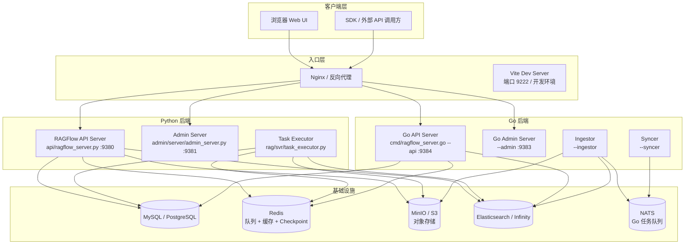
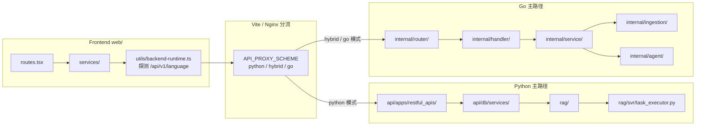
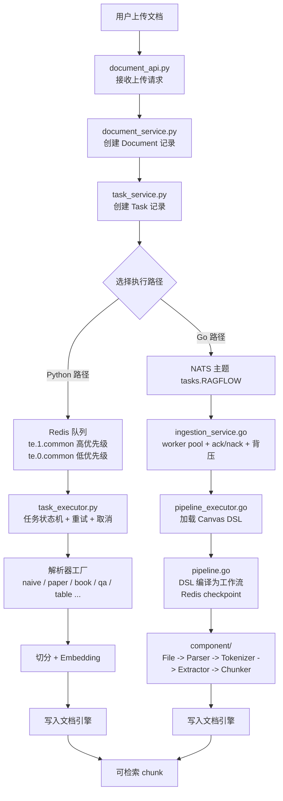
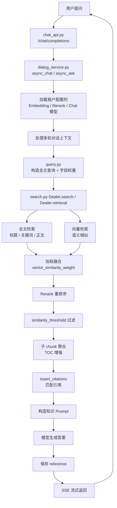
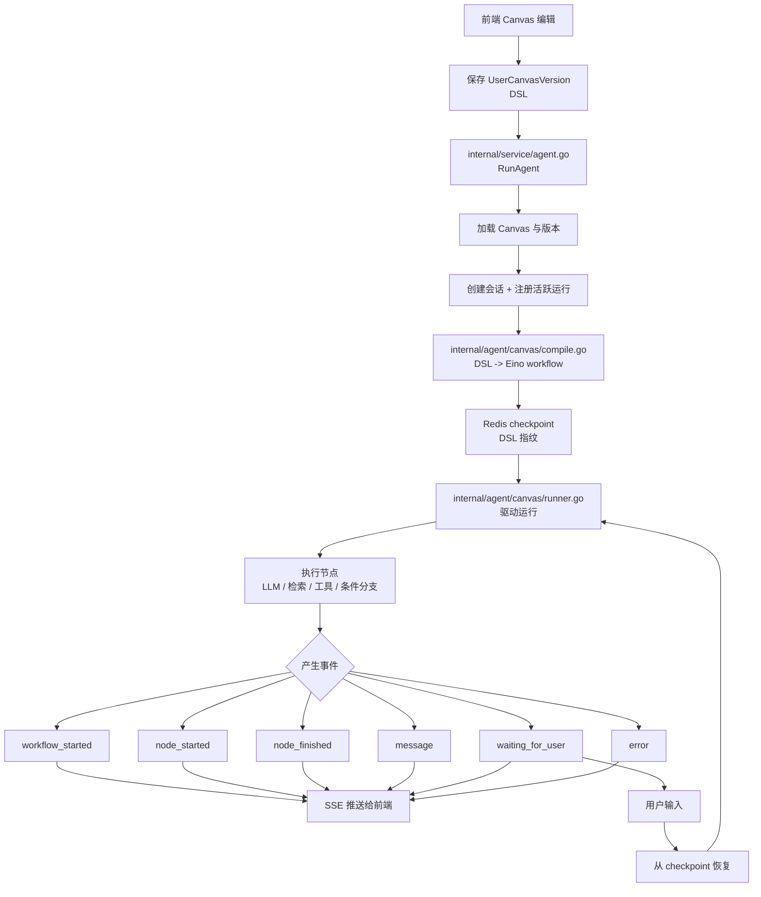
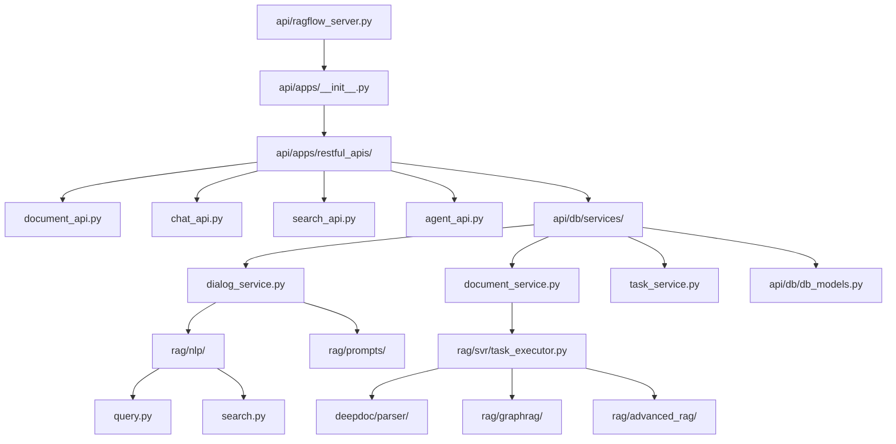
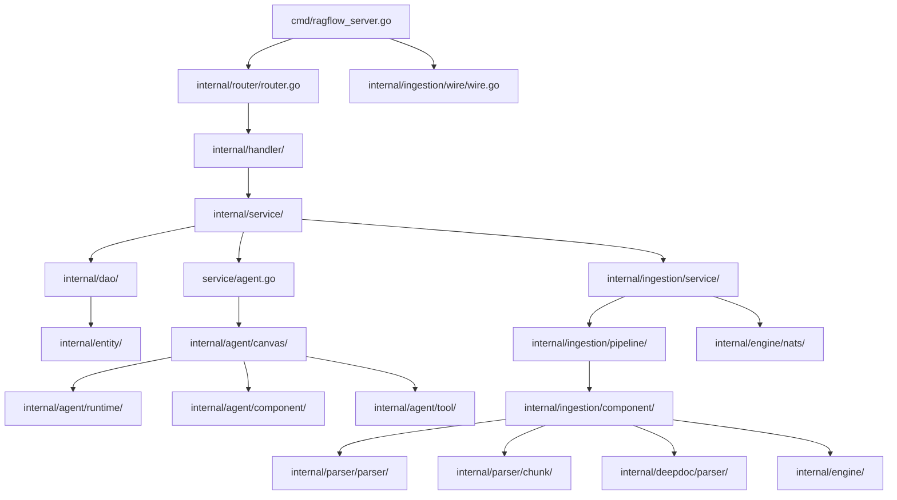
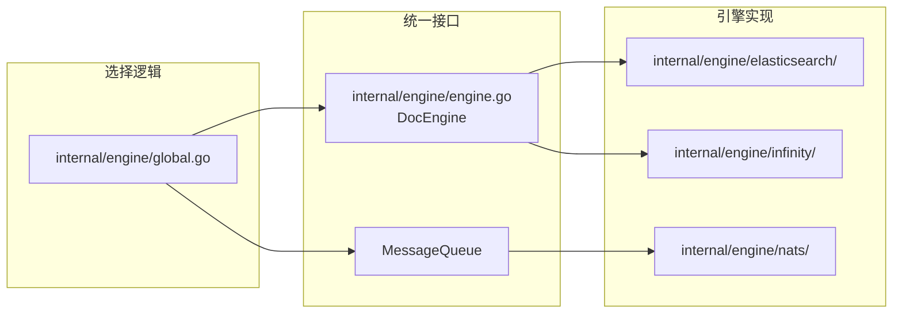

# RAGFlow 源码学习路线

本文面向第一次接触 RAGFlow 的开发者，目标是让你从"能跑起来"走到"能改主路径"。阅读顺序刻意设计成：**先建立业务概念，再理解模块边界，最后落到源码文件**。每一节都会先回答三个问题：

1. 这个概念通俗来说是什么？
2. 它解决实际业务里的什么问题？
3. 它如何影响准确性、召回率、延迟、成本、安全或审计？
4. 它在源码里的落点在哪里？

:::tip 学习原则
不要一开始就逐行读代码。RAGFlow 同时存在 Python 与 Go 两套后端、多种文档引擎、异步任务队列和 Agent 工作流引擎，逐行读会迷路。正确的做法是：先沿着一条完整业务链路走一遍，再回头补齐每个模块的细节。
:::

---

## 一、先建立业务全景

### 1.1 RAGFlow 是什么

RAGFlow 是一个**基于深度文档理解的 RAG 引擎**。它做的事情可以概括为一句话：

> 把企业散落的文档变成可检索、可引用、可追踪的知识，再让大模型基于这些知识回答问题或执行工作流。

它和普通聊天机器人的区别在于：答案不是模型"回忆"出来的，而是先从你的文档里检索出证据，再让模型基于证据生成。这条链路里的每个环节都会影响最终答案的可靠性。

### 1.2 服务拓扑

RAGFlow 不是一个单体进程，而是由多个服务协作组成的系统。理解拓扑是读源码的第一步。



**关键源码入口：**

| 组件 | 源码路径 | 默认端口 |
|---|---|---|
| Python API Server | `api/ragflow_server.py` | 9380 |
| Python Admin Server | `admin/server/admin_server.py` | 9381 |
| Go API Server | `cmd/ragflow_server.go` (`--api`) | 9384 |
| Go Admin Server | `cmd/ragflow_server.go` (`--admin`) | 9383 |
| Python Task Executor | `rag/svr/task_executor.py` | 无 HTTP 端口 |
| Go Ingestor | `cmd/ragflow_server.go` (`--ingestor`) | 无 HTTP 端口 |

端口默认值来自 `docker/service_conf.yaml.template`、`internal/server/config/api_server_config.go` 和 `internal/server/config/admin_config.go`，实际部署以配置文件为准。

### 1.3 Python 与 Go 的边界

这是初学者最容易困惑的地方：为什么同一个项目有两套后端？它们的分工是什么？



- `web/vite.config.ts` 定义了 `python`、`hybrid`、`go` 三种代理方案，默认是 `python`。
- `web/src/utils/backend-runtime.ts` 在应用启动时请求 `/api/v1/language`，判断当前后端是 Python 还是 Go，并缓存结果。
- Go 侧正在承接越来越多的摄取、Agent 和检索能力，但 Python 侧仍是大量 REST API、业务服务和 RAG 算法的主实现。
- 学习时不要假设"Go 已经全部替代 Python"。以 `internal/router/router.go` 和 `api/apps/restful_apis/` 的实际路由为准。

---

## 二、核心概念详解

这一节是本文最重要的部分。每个概念都会先解释"它是什么"，再解释"为什么业务需要它"。

### 2.1 RAG（检索增强生成）

**通俗含义：** RAG = Retrieval Augmented Generation。模型回答前先去知识库"查资料"，把查到的证据放进提示词，再让模型基于证据写答案。

**业务作用：** 企业文档每天都在变，不可能靠重新训练模型来更新知识。RAG 让知识更新变成"更新文档"而不是"重训模型"，成本从百万级降到可接受范围。同时，因为答案有出处，业务方可以审计"这个结论是从哪份文档的哪一段来的"。

**业务影响：**

- 准确性：取决于检索质量和文档解析质量，不是模型越大越准。
- 延迟：多了一次检索和一次更长的提示词推理，通常比直接问答慢。
- 成本：提示词变长会增加 token 成本，但远低于微调。
- 审计：引用让答案可追溯，这是 RAG 相对微调的核心优势。

**源码路径：** `api/db/services/dialog_service.py`、`rag/nlp/search.py`、`rag/prompts/`。

### 2.2 Dataset / 知识库

**通俗含义：** 一组文档的集合，通常对应一个业务主题，比如"产品手册""法务合同""客服 FAQ"。

**业务作用：** 知识库是权限、检索范围和配置的最小业务单元。不同部门的知识库互相隔离；同一个问题可以在指定知识库里检索，避免跨部门串数据。

**业务影响：**

- 安全：知识库边界就是数据访问边界，决定了谁能问什么。
- 召回率：知识库切得太粗会引入噪声，切得太细会漏掉关联信息。
- 成本：每个知识库可以配置不同的 Embedding 模型和解析器。

**源码路径：** `api/db/db_models.py` 中的 `Knowledgebase`；Python 服务 `api/db/services/knowledgebase_service.py`；Go 实体 `internal/entity/`。

### 2.3 Document / Chunk / Token

**通俗含义：** Document 是上传的原始文件；Chunk 是解析后切出来的片段；Token 是模型和检索器实际处理的最小文本单位。

**业务作用：** 大模型一次能读的文本有限，所以必须把长文档切成片段。切得好，检索能命中关键信息；切得差，一个完整语义被拆散，检索出来的片段读不懂。

**业务影响：**

- 召回率：chunk 太大，检索命中后噪声多；chunk 太小，语义不完整。
- 准确性：表格、标题、跨页段落如果被切断，答案会缺失。
- 成本：chunk 数量决定索引规模和检索成本。

**源码路径：**

- Python 解析：`deepdoc/parser/`、`rag/flow/chunker/`
- Go 解析：`internal/parser/parser/`、`internal/parser/chunk/`、`internal/ingestion/component/chunker/`
- 数据模型：`api/db/db_models.py` 中的 `Document`

### 2.4 Parser（解析器）

**通俗含义：** 把 PDF、Word、Excel、图片等非结构化文件，转成带结构的文本、表格和图片描述。

**业务作用：** 这是 RAG 质量的地基。PDF 里的双栏排版、扫描件、跨页表格、公式，如果解析错了，后面检索再准也没用。RAGFlow 的核心竞争力很大一部分就在这里。

**业务影响：**

- 准确性：解析决定"证据本身是否正确"。
- 成本：OCR 和视觉模型解析比纯文本解析贵得多。
- 延迟：复杂 PDF 解析可能是整个摄取流程里最慢的一步。

**源码路径：**

- Python：`deepdoc/parser/`，解析器工厂在 `rag/svr/task_executor.py`，支持 `naive`、`paper`、`book`、`qa`、`table`、`resume`、`picture`、`audio`、`email` 等。
- Go：`internal/ingestion/component/parser.go`、`internal/parser/parser/`、`internal/deepdoc/parser/`。
- 注意：Go Ingestor 当前在 `cmd/ragflow_server.go` 中声明支持 `pdf`、`docx`、`txt` 作为摄取类型；其他文件族会走对应的回退路径。以代码为准，不要假设与 Python 完全等价。

### 2.5 Embedding（向量化）

**通俗含义：** 把一段文本映射成一串数字（向量），语义相近的文本在向量空间里距离更近。

**业务作用：** 用户问"怎么退货"，文档里写的是"退款流程"，字面不匹配但语义接近。向量检索能跨过字面差异找到它，这是关键词检索做不到的。

**业务影响：**

- 召回率：Embedding 模型决定了语义匹配能力。
- 成本：向量化有 API 成本或 GPU 成本，索引有存储成本。
- 延迟：向量检索通常比全文检索快，但需要额外模型调用。

**源码路径：** Python 侧在 `api/db/services/dialog_service.py` 加载模型，检索在 `rag/nlp/search.py`；模型定义在 `api/db/db_models.py` 的 `LLM`、`TenantLLM`。

### 2.6 全文检索、向量检索与混合检索

**通俗含义：** 全文检索按关键词匹配，向量检索按语义相似匹配，混合检索把两者结果融合。

**业务作用：** 单一检索都有盲区。全文检索擅长精确匹配型号、编号、专有名词；向量检索擅长自然语言提问。混合检索让两边的优势互补，是生产环境的默认选择。

**业务影响：**

- 召回率：混合检索通常显著优于单一检索。
- 准确性：需要调 `vector_similarity_weight` 平衡两路结果。
- 延迟：多一路检索，延迟略增。

**源码路径：** `rag/nlp/query.py` 负责构造全文查询和字段权重；`rag/nlp/search.py` 的 `Dealer.search`、`Dealer.retrieval` 负责全文查询、向量查询和加权融合。关键参数包括 `similarity_threshold`、`vector_similarity_weight`、`rerank_mdl`。

### 2.7 Rerank（重排序）

**通俗含义：** 召回阶段先取回一批候选，再用更精细的模型对候选重新打分排序。

**业务作用：** 召回要快，所以用便宜的粗排；但粗排结果里常常把相关片段排在后面。Rerank 用更强的模型重新排序，把真正有用的片段提到前面，直接提升答案质量。

**业务影响：**

- 准确性：通常是提升答案质量性价比最高的一步。
- 延迟：多一次模型调用，是检索链路的主要延迟来源之一。
- 成本：取决于用的是外部 rerank 服务还是本地模型。

**源码路径：** `rag/nlp/search.py` 支持外部 rerank 和 Elasticsearch KNN 二次评分；Infinity 按其融合分数处理。模型配置在 `api/db/services/dialog_service.py`。

### 2.8 引用与 Grounding

**通俗含义：** Grounding 是"让答案有事实依据"；引用是把这个依据显式标出来，指出答案来自哪个文档的哪一段。

**业务作用：** 企业场景里，一个没有出处的答案几乎没有价值，因为没人敢用。引用让业务人员能一键核对原文，也让合规审计有据可查。

**业务影响：**

- 审计：这是 RAG 进入生产的关键前提。
- 信任：用户能看到出处，才愿意采纳答案。
- 延迟：插入引用需要额外的片段匹配和拼接。

**源码路径：** `rag/nlp/search.py` 中的 `insert_citations`；`api/db/services/dialog_service.py` 负责在生成答案后插入引用；`api/apps/restful_apis/chat_api.py` 负责保存 reference。

### 2.9 Prompt 与上下文窗口

**通俗含义：** Prompt 是发给模型的完整指令，包含系统提示、历史对话、检索到的证据和用户问题；上下文窗口是模型一次能接收的最大 token 数。

**业务作用：** 检索到的片段不能无限塞进 Prompt。塞太多，成本和延迟上升，还可能引入噪声让模型分心；塞太少，证据不足。Prompt 构造本质上是在有限预算内做证据选择。

**业务影响：**

- 准确性：证据排布和去重直接影响答案。
- 成本：Prompt 长度直接等于 token 花费。
- 延迟：Prompt 越长，推理越慢。

**源码路径：** `rag/prompts/`、`api/db/services/dialog_service.py`。

### 2.10 Agent / Canvas / DSL / Workflow

**通俗含义：** Agent 是能按流程调用工具、检索知识、做判断的程序化助手；Canvas 是前端可视化的流程画布；DSL 是画布保存下来的结构化流程定义；Workflow 是 DSL 编译后可执行的运行时图。

**业务作用：** 单纯的问答只能"回答问题"。真实业务需要"先查客户资料，再查合同条款，再调用审批接口，最后生成报告"。Agent 把多个步骤编排起来，让 RAG 从问答走向业务自动化。

**业务影响：**

- 能力边界：决定系统能做多复杂的事。
- 安全：Agent 能调工具，意味着需要权限控制和审计。
- 成本：多步骤会多次调用模型和工具，成本远高于单次问答。

**源码路径：**

- Go 主路径：`internal/agent/canvas/compile.go`（DSL 编译）、`internal/agent/canvas/runner.go`（执行驱动）、`internal/agent/runtime/registry.go`（组件注册）、`internal/agent/component/`（组件实现）、`internal/agent/tool/`（工具实现）、`internal/service/agent.go`（服务入口）。
- 前端：`web/src/pages/agent/`、`web/src/pages/agents/`、`web/src/services/agent-service.ts`。

### 2.11 State / Checkpoint / Interrupt

**通俗含义：** State 是工作流运行时的全部状态；Checkpoint 是状态的持久化快照；Interrupt 是流程中途暂停、等待用户输入，之后从断点恢复。

**业务作用：** 一个复杂工作流可能跑几分钟、调用多个外部系统。如果中途失败，不能从头再来。Checkpoint 让流程可恢复；Interrupt 让流程可以在关键节点让人类确认，这是"人在回路"的业务刚需。

**业务影响：**

- 可靠性：没有 Checkpoint，长流程失败就要重跑，成本和副作用都不可控。
- 体验：Interrupt 让 Agent 能停下来问问题，而不是猜错。
- 一致性：恢复时需要保证 DSL 没有变化，否则断点语义会错位。

**源码路径：** `internal/agent/runtime/state.go` 定义 `CanvasState`，包含 `Outputs`、`Sys`、`Env`、`Path`、`History`、`Memory`、`Retrieval`、`Globals`、`CancelFlag`、`RunID`、`SessionID`；`internal/agent/canvas/compile.go` 负责 checkpoint、serializer 和节点中断；`internal/service/agent.go` 负责 Redis checkpoint 和取消控制。

### 2.12 异步任务、队列、重试、幂等与背压

**通俗含义：** 文档摄取很慢，不能卡住 API 请求，所以丢进队列后台处理。重试是失败后自动再试；幂等是同一个任务执行多次结果一致；背压是系统忙不过来时主动减速。

**业务作用：** 用户上传 1000 个 PDF，API 必须立刻返回"已接收"，后台慢慢处理。如果某个文件解析失败，系统要能重试；如果重试导致同一文档被索引两次，检索结果就会重复，所以必须幂等。

**业务影响：**

- 可靠性：决定大批量摄取能否稳定完成。
- 成本：无脑重试会放大成本，需要退避和上限。
- 一致性：幂等是防止重复索引的关键。
- 稳定性：背压防止系统被突发流量打垮。

**源码路径：**

- Python：Redis 队列。`common/settings.py` 中的 `get_svr_queue_name` 生成 `te.{priority}.common`，优先级顺序是 `1` 高于 `0`。任务状态机、重试、取消标记和进度更新在 `rag/svr/task_executor.py` 与 `rag/svr/task_executor_refactor/task_manager.py`。
- Go：NATS 队列，主题为 `tasks.RAGFLOW`，定义在 `internal/common/task.go`。消费、worker pool、任务状态切换、去重、ack/nack、背压和取消在 `internal/ingestion/service/ingestion_service.go`。

### 2.13 GraphRAG、RAPTOR 与知识编译

**通俗含义：** GraphRAG 从文档里抽取实体和关系，构建知识图谱，回答需要跨文档推理的问题；RAPTOR 把文档做层次化摘要，支持"先看全局再看细节"；知识编译是把原始片段加工成更高层的知识产品。

**业务作用：** 有些问题无法通过单段检索回答，比如"这几个供应商之间有什么关联风险"。这类问题需要跨文档、跨实体推理。GraphRAG 和知识编译就是为这类需求准备的。

**业务影响：**

- 准确性：对多跳问题效果显著。
- 成本：构建图谱和摘要的摄取成本远高于普通索引。
- 延迟：图查询和层次检索路径更长。
- 限制：并非所有业务都需要，普通 FAQ 场景用普通 RAG 更划算。

**源码路径：** `rag/graphrag/search.py`、`rag/graphrag/general/`、`rag/graphrag/light/`、`rag/advanced_rag/knowlege_compile/`、`internal/ingestion/component/knowledge_compiler/`、`internal/ingestion/knowledge_compile/`。

### 2.14 Agentic RAG 与 Deep Research

**通俗含义：** 普通 RAG 是"检索一次就回答"；Agentic RAG 会根据问题决定检索几次、检索什么、是否需要分解子问题、是否需要多轮研究。

**业务作用：** 复杂问题往往需要多步检索。比如"对比 A 和 B 两个方案的合规风险"，需要分别检索 A、B，再综合。Agentic RAG 把这种研究过程自动化。

**业务影响：**

- 准确性：复杂问题上明显优于单次检索。
- 成本：多次检索和多轮模型调用，成本成倍上升。
- 延迟：从秒级变成十秒级甚至分钟级。
- 适用性：简单问题用它会浪费，所以需要路由判断。

**源码路径：** `rag/advanced_rag/agentic_rag_graph.py` 定义了 LangGraph 节点链路：`formalize_question -> route -> pre_search -> planner -> orchestrator_loop -> formalize_answer`，低/中/高/超深模式分别对应直接搜索、分解搜索、Agentic Research 和 Deep Research；`rag/advanced_rag/agentic_rag.py`、`rag/advanced_rag/harness/` 是配套实现。

### 2.15 多租户、权限与审计

**通俗含义：** 多租户是多个组织或团队共用一套系统但数据隔离；权限控制谁能读、谁能写、谁能调模型；审计记录谁在什么时候做了什么。

**业务作用：** 企业内部不同部门、不同客户的数据不能互相看到。这是 RAG 进入企业的合规前提。

**业务影响：**

- 安全：租户边界一旦破了，可能造成数据泄露。
- 合规：审计日志是很多行业的硬性要求。
- 性能：权限过滤会加在检索条件上，影响查询效率。

**源码路径：** `api/db/db_models.py` 中的 `User`、`Tenant`、`UserTenant`；`api/apps/auth/`；Go 侧 `internal/handler/`、`internal/dao/`。

---

## 三、顶层目录分析

先建立目录地图，再决定从哪里开始读。

| 目录 | 职责 | 学习优先级 |
|---|---|---|
| `api/` | Python API Server、REST 路由、数据库服务 | 高 |
| `rag/` | 检索、LLM 集成、GraphRAG、高级 RAG | 高 |
| `deepdoc/` | Python 文档解析与 OCR | 高 |
| `agent/` | Python Agent 工作流与组件 | 中 |
| `cmd/` | Go 二进制入口 | 高 |
| `internal/` | Go 主应用代码 | 高 |
| `internal/ingestion/` | Go 摄取流水线 | 高 |
| `internal/parser/` | Go 解析与切分库 | 高 |
| `internal/deepdoc/` | Go 原生 PDF/DOCX 解析 | 中 |
| `internal/agent/` | Go Agent 运行时 | 高 |
| `internal/engine/` | 文档引擎与消息队列抽象 | 高 |
| `internal/entity/` | Go 共享实体 | 中 |
| `internal/dao/` | Go 数据访问 | 中 |
| `internal/handler/` | Go HTTP 处理 | 中 |
| `internal/router/` | Go 路由注册 | 高 |
| `internal/service/` | Go 业务服务 | 高 |
| `internal/server/` | Go 配置与启动 | 中 |
| `web/` | React + TypeScript 前端 | 中 |
| `docker/` | 本地与生产编排 | 中 |
| `sdk/` | SDK | 低 |
| `test/` | 自动化测试 | 中 |

---

## 四、核心流程图解

### 4.1 文档摄取流程

这是理解 RAGFlow 的主链路之一：一份文档从上传到变成可检索的 chunk，中间经历了什么。



**要点：**

- Python 路径用 Redis 队列，优先级顺序是 `1` 高于 `0`。
- Go 路径用 NATS，主题统一为 `tasks.RAGFLOW`，摄取、记忆提取等任务共享消费者和 worker pool，按 `TaskType` 分发。
- Go 路径的组件注册收敛在 `internal/ingestion/wire/wire.go`：它集中 blank-import 组件包，触发各组件的 `init()` 注册，避免每个 entrypoint 重复维护导入列表。
- Go 知识编译产物先以 `available_int=0` 写入隐藏状态，等待数据集级消费者合并后再可见，避免检索到半成品。

### 4.2 检索问答流程

这是另一条主链路：用户提问后，系统如何找到证据并生成带引用的答案。



**要点：**

- `rag/nlp/query.py` 负责查询构造和字段权重，比如标题、重要关键词、问题关键词、正文的权重不同。
- `rag/nlp/search.py` 负责全文查询、向量查询和 weighted sum 融合。
- 支持外部 rerank、ES KNN 二次评分；Infinity 按其融合分数处理。
- `insert_citations`、`fetch_chunk_vectors`、子 chunk 聚合和 TOC 增强都在检索链路的后处理阶段。
- `chat_api.py` 负责 SSE 流式输出、会话持久化和 reference 保存。

### 4.3 Agent 工作流执行流程



**要点：**

- `internal/agent/canvas/compile.go` 把 Canvas DSL 编译为 Eino workflow，处理 checkpoint、serializer、节点中断和 override params。
- `internal/agent/canvas/runner.go` 驱动一次运行，产生 SSE 事件，支持中断恢复、取消和 panic 恢复。
- `internal/agent/runtime/registry.go` 按 `agent`、`ingestion`、`shared` 分类注册组件。
- `internal/agent/runtime/state.go` 定义 `CanvasState`，承载运行时全部状态。
- `internal/service/agent.go` 负责加载 Canvas、创建会话、注册活跃运行、调用 workflow、Redis checkpoint 和取消控制。

---

## 五、分阶段源码学习路线

### 阶段一：启动与结构（1 到 2 天）

**目标：** 能说清楚项目怎么启动、前后端怎么分流、有哪些服务。

**阅读顺序：**

1. `README_zh.md`：项目定位与快速上手。
2. `internal/development.md`：开发环境与 Go 构建约定。
3. `api/ragflow_server.py`：Python 服务入口。
4. `api/apps/__init__.py`：Quart 应用装配，初始化数据库、运行时配置、Redis 进度更新线程和渠道服务。
5. `cmd/ragflow_server.go`：Go 二进制入口，理解 `--api`、`--admin`、`--ingestor`、`--syncer` 四种模式。
6. `internal/router/router.go`：Go 路由注册。
7. `web/src/main.tsx`、`web/src/app.tsx`、`web/src/routes.tsx`：前端入口与路由。
8. `web/vite.config.ts`、`web/src/utils/backend-runtime.ts`：前端如何判断走 Python 还是 Go。

**验证方法：** 画出你自己理解的服务拓扑图，和本文的图对比。

### 阶段二：业务数据模型（2 到 3 天）

**目标：** 理解 RAGFlow 的业务对象和它们的关系。

**阅读顺序：**

1. `api/db/db_models.py`：`User`、`Tenant`、`UserTenant`、`LLM`、`TenantLLM`、`Knowledgebase`、`Document`、`Task`、`Dialog`、`Conversation`、`UserCanvas`、`UserCanvasVersion`。
2. `api/db/services/document_service.py`：文档生命周期。
3. `api/db/services/knowledgebase_service.py`：知识库配置与权限。
4. `api/db/services/task_service.py`：任务状态流转。
5. `internal/entity/`、`internal/dao/`：Go 侧对应实体和数据访问。

**验证方法：** 画出 `Tenant -> Knowledgebase -> Document -> Task` 的实体关系图。

### 阶段三：文档摄取（3 到 5 天）

**目标：** 能完整追踪一份文档从上传到可检索的过程。

**Python 路径：**

1. `api/apps/restful_apis/document_api.py`
2. `api/db/services/document_service.py`
3. `api/db/services/task_service.py`
4. `rag/svr/task_executor.py`
5. `rag/svr/task_executor_refactor/task_manager.py`
6. `common/settings.py`：队列命名与优先级。

**Go 路径：**

1. `internal/ingestion/service/ingestion_service.go`：NATS 消费、worker pool、状态切换、去重、ack/nack、背压、取消。
2. `internal/ingestion/task/pipeline_executor.go`：加载 DSL、运行 pipeline、规范化 chunk、写索引。
3. `internal/ingestion/pipeline/pipeline.go`：DSL 到 Eino 工作流编译、Redis checkpoint、恢复安全性。
4. `internal/ingestion/wire/wire.go`：组件注册收敛点。
5. `internal/ingestion/component/`：`file.go`、`parser.go`、`tokenizer.go`、`chunker/`。

**验证方法：** 找一份实际文档，在日志里追踪它的任务 ID，看它经过哪些状态。

### 阶段四：解析、切分与索引（3 到 5 天）

**目标：** 理解高精度解析和切分策略。

**阅读顺序：**

1. `deepdoc/parser/`：Python 解析器。
2. `internal/parser/parser/`：Go 类型化解析器。
3. `internal/deepdoc/parser/`：Go 原生 PDF/DOCX 解析。
4. `internal/parser/chunk/`：Go chunk 操作库。
5. `rag/flow/chunker/`：Python 切分流程。
6. `rag/nlp/`：分词、同义词、短语匹配。
7. `internal/engine/`：文档引擎抽象与实现。

**验证方法：** 用同一份 PDF 分别走 Python 和 Go 解析路径，对比输出 chunk 差异。

### 阶段五：检索与问答（3 到 5 天）

**目标：** 理解检索融合、rerank 和答案生成。

**阅读顺序：**

1. `rag/nlp/query.py`：查询构造和字段权重。
2. `rag/nlp/search.py`：`Dealer.search`、`Dealer.retrieval`、融合和 rerank。
3. `api/apps/restful_apis/chat_api.py`：`/chat/completions` 和 SSE。
4. `api/apps/restful_apis/search_api.py`：`/searches/<id>/completions`。
5. `api/db/services/dialog_service.py`：`async_chat`、`async_ask`、`rag_agent`。
6. `rag/prompts/`：提示词模板。

**验证方法：** 用同一个问题分别测试纯全文、纯向量和混合检索，对比返回片段和最终答案。

### 阶段六：高级检索能力（3 到 5 天）

**目标：** 理解 GraphRAG、知识编译和 Agentic RAG。

**阅读顺序：**

1. `rag/graphrag/search.py`
2. `rag/graphrag/general/`、`rag/graphrag/light/`
3. `rag/advanced_rag/agentic_rag_graph.py`
4. `rag/advanced_rag/agentic_rag.py`、`rag/advanced_rag/harness/`
5. `rag/advanced_rag/knowlege_compile/`
6. `internal/ingestion/component/knowledge_compiler/`、`internal/ingestion/knowledge_compile/`

**验证方法：** 构造一个需要跨文档推理的问题，对比普通 RAG 和 Agentic RAG 的答案质量与耗时。

### 阶段七：Agent 工作流（5 到 7 天）

**目标：** 能读懂一个 Canvas 从 DSL 到执行的全过程。

**阅读顺序：**

1. `internal/agent/canvas/compile.go`：DSL 编译。
2. `internal/agent/canvas/runner.go`：执行驱动与 SSE 事件。
3. `internal/agent/runtime/registry.go`：组件注册。
4. `internal/agent/runtime/state.go`：`CanvasState`。
5. `internal/agent/component/`：组件实现。
6. `internal/agent/tool/`：工具实现。
7. `internal/agent/harness/`：高级检索编排。
8. `internal/service/agent.go`：`RunAgent` 服务入口。
9. `web/src/pages/agent/`、`web/src/pages/agents/`、`web/src/services/agent-service.ts`、`web/src/hooks/use-agent-request.ts`。

**验证方法：** 在 Canvas 里搭一个"检索 + LLM + 条件分支"的最小工作流，观察 SSE 事件序列。

### 阶段八：前端页面（3 到 5 天）

**目标：** 能定位前端页面、服务和请求钩子。

**阅读顺序：**

1. `web/src/services/`：API 服务层。
2. `web/src/hooks/`：请求钩子。
3. `web/src/pages/datasets/`、`web/src/pages/dataset/`：知识库与文档管理。
4. `web/src/pages/next-chats/`：对话页面。
5. `web/src/pages/next-search/`：搜索页面。
6. `web/src/pages/agent/`、`web/src/pages/agents/`：Agent 画布。

### 阶段九：开发与测试实践

**目标：** 能在本地做修改并验证。

**Python：**

```bash
uv run pytest
ruff check
ruff format
```

**Go：** 不要用裸 `go test`、`go build`，它们会漏掉 `build.sh` 配置的 CGO 标志和原生静态库。

```bash
bash build.sh --test ./path/to/package/...
bash build.sh --test-integration ./...
bash build.sh --test-e2e
bash build.sh --test-manual
```

**前端：**

```bash
cd web
npm run lint
npm run type-check
npm run test
```

**测试分层速查：**

| 层级 | 构建标签 | 默认运行 | 依赖 |
|---|---|---|---|
| Unit | 无 | 是 | 无外部服务 |
| Integration | `integration` | 否 | 真实 MySQL / MinIO / ES / Infinity / LLM |
| E2E | `e2e` | 否 | 完整跨组件链路 |
| Manual | `manual` | 否 | 非常慢，仅本地手动 |

---

## 六、模块依赖关系

### 6.1 Python 侧模块关系



### 6.2 Go 侧模块关系



### 6.3 存储与引擎抽象



**要点：**

- `internal/engine/engine.go` 定义 `DocEngine` 接口，包含 `InsertChunks`、`Search`、`GetChunk`、metadata、SQL、KNN、分页、pagerank 等能力。
- `internal/engine/global.go` 根据配置选择引擎，当前支持 `elasticsearch` 和 `infinity`，消息队列支持 `nats`。
- `internal/engine/README.md` 说明了引擎接口和各实现目录的职责。

---

## 七、调试与排查

### 7.1 追踪一份文档的完整生命周期

1. 从 `document_api.py` 确认文档 ID。
2. 在 `api/db/db_models.py` 的 `Task` 记录里找到任务 ID 和状态。
3. Python 路径：在 `rag/svr/task_executor.py` 的日志里搜任务 ID。
4. Go 路径：在 `internal/ingestion/service/ingestion_service.go` 的日志里搜任务 ID。
5. 在文档引擎里按文档 ID 查 chunk，确认是否写入成功。

### 7.2 常见误区

| 误区 | 实际情况 |
|---|---|
| "Go 已经全量替代 Python" | 两者并存，按路由和入口判断实际执行路径 |
| "解析只是读文本" | 表格、跨页、扫描件、公式都是解析难点 |
| "检索一次就够了" | 复杂问题需要分解、多轮检索或图推理 |
| "向量检索比全文检索好" | 精确匹配场景全文检索更可靠 |
| "Rerank 只是优化" | 对答案质量影响很大，通常是性价比最高的一步 |
| "重试没有副作用" | 没有幂等保障的重试会造成重复索引 |
| "文档引擎可以随意切换" | 不同引擎能力不同，切换前要看实现目录 |
| "Checkpoint 可有可无" | 长流程没有 checkpoint，失败就要重跑 |

### 7.3 日志与可观测性入口

- Python 服务日志：`api/ragflow_server.py` 启动时的日志配置。
- Python worker 日志：`rag/svr/task_executor.py`。
- Go 服务日志：`internal/common/` 的日志封装。
- Agent 运行事件：`internal/agent/canvas/runner.go` 的 SSE 事件。
- 任务进度：Python 用 Redis 进度更新线程；Go 用任务状态切换。

---

## 八、学习检查清单

读完本文后，你应该能回答：

- [ ] RAGFlow 有哪些服务，各自监听什么端口？
- [ ] 前端如何判断走 Python 还是 Go？
- [ ] 一份 PDF 从上传到可检索，经过了哪些文件和状态？
- [ ] 全文检索、向量检索、混合检索分别在哪里实现？
- [ ] Rerank 在哪一步介入，参数是什么？
- [ ] 引用是如何插入到答案里的？
- [ ] Canvas DSL 是如何编译成可执行工作流的？
- [ ] Checkpoint 和 Interrupt 解决什么问题？
- [ ] Python 和 Go 的队列分别是什么，主题和优先级如何定义？
- [ ] 如何为一次修改选择正确的测试命令？

如果这些问题你都能不看答案说清楚，就已经具备了改主路径的基础。
