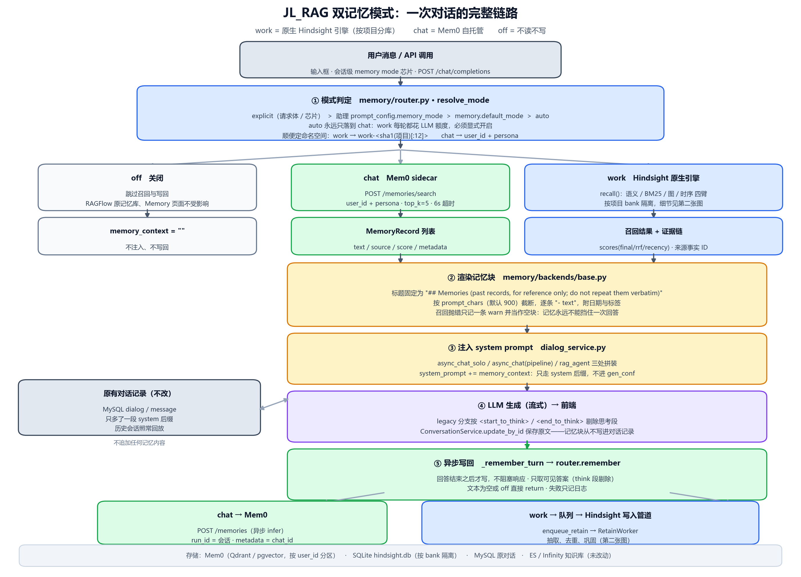
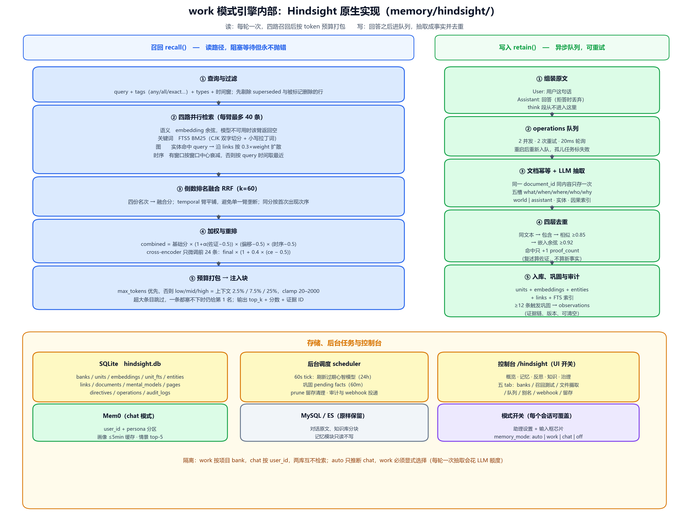

# Dual Memory Modes

RAGFlow keeps two optional long-term memories next to its built-in memory library and routes each chat turn to one of them:

| Mode | Backend | What it stores | Where it lives |
| --- | --- | --- | --- |
| `work` | [Hindsight](https://github.com/vectorize-io/hindsight), ported into `memory/hindsight/` | Project knowledge: decisions, conventions, open questions, what was already tried | One SQLite bank per project, `work-<sha1(project)[:12]>`, plus that bank's vectors in the tenant's Elasticsearch index |
| `chat` | Self-hosted [Mem0](https://github.com/mem0ai/mem0) | A picture of the person: preferences, habits, recent personal events | Mem0 sidecar + Qdrant |
| `off` | none | Nothing is read or written | - |

The built-in memory library (the **Memory** page, agent message memory and the Retrieval tool) is untouched: it keeps working exactly as before, and neither mode reads or writes to it. Dual memory is an additional context source for the chat completion path, not a replacement.

## The whole flow at a glance

One chat turn, end to end: the mode is resolved, the matching store is queried, the recalled records are rendered into a small text block and appended to the system prompt, and only after the answer has been streamed is the turn written back — asynchronously, never on the critical path. The conversation record itself is not touched: the memory block lives in the system prompt only, so old threads replay exactly as before.



Inside work mode, the Hindsight port splits into a read path (four retrieval arms fused with reciprocal rank fusion, scored, re-ranked and packed into a token budget) and a write path (queue, extraction, four-layer deduplication, storage and consolidation):



## How a mode is chosen

The first match wins:

1. `memory_mode` in the chat request body (an explicit switch from a client, script or UI).
2. `prompt_config.memory_mode` of the chat assistant (persisted per assistant).
3. `memory.default_mode` from `conf/service_conf.yaml` (defaults to `auto`).
4. `auto` resolves to `chat` for every assistant. `work` is never inferred: it runs the Hindsight engine, which spends LLM quota on extraction, consolidation and reflect, so it only runs when steps 1-3 select it.

In the web UI, open a chat assistant **> Prompt engine** and pick a value from **Memory mode**. Leave it on **Auto** unless you want to pin an assistant to work memory.

A conversation can also override that setting for itself: the **Memory** chip in the chat composer (next to the thinking and internet toggles) sends `memory_mode` with every completion. It is a per-conversation switch, not a setting - nothing is saved to the assistant, and **Auto** hands control back to the assistant setting. Use it to keep one thread on work memory while everything else stays free.

## Work mode: Hindsight project memory

The engine is a source-level port of [vectorize-io/hindsight](https://github.com/vectorize-io/hindsight), not a client of it: `memory/hindsight/` implements the retain, recall, consolidation and reflect pipeline against a local SQLite file for the relational data (banks, documents, chunks, facts, links, audit) and a vector database for the embeddings, and its LLM and embedding calls reuse the chat and embedding models the current tenant already configured in RAGFlow. There is no extra service, port or API key to run.

Embeddings live in the document store RAGFlow is already deployed with: an Elasticsearch `dense_vector` field, searched with kNN, in an index named `<vector_index_prefix>_<tenant_id>` (one index per tenant, one filter per bank). The same vectors are still written to SQLite, which is what recall falls back to when Elasticsearch is unreachable, so losing the vector database costs the semantic arm precision, not the arm itself. `vector_backend: sqlite` keeps everything in the file (the pre-vector behaviour), and `POST /api/v1/hindsight/banks/<bank>/vector-index/rebuild` re-indexes a bank from the stored vectors without re-embedding; `GET .../vector-index` reports the backend, index, dimensions, dirty flag and how many vectors each side holds.

The port keeps the mechanisms that make Hindsight different from appending raw memories:

- **retain** - five-slot fact extraction (what / when / where / who / why), fact types, an event time span, entity resolution, causal and co-mention links, document upsert, tags, duplicate text treated as extra proof, and an optional defence that drops secrets.
- **recall** - four arms (semantic, BM25 over FTS5, graph, temporal) fused with reciprocal rank fusion (k = 60), then re-scored with recency, temporal and proof-count signals, observation preference, and a token budget derived from `budget` / `max_tokens`.
- **consolidation** - batches of new facts are merged into observations that keep their source fact ids and a proof count, so the same preference stated twice gets stronger rather than duplicated.
- **reflect** - a bounded search-then-answer loop that may only cite evidence it actually retrieved.
- **console** - banks, memories, consolidated observations, mental models, knowledge pages, directives, documents, operations and an audit log.

Each project gets its own bank: the namespace is `work-<sha1(project)[:12]>`, where `project` comes from the request, then the assistant `memory_project`, then `memory.hindsight.project`, then the server process cwd. Two repositories therefore never read each other's memory, and clearing one bank leaves the others alone.

```yaml
memory:
  hindsight:
    db_path: ''            # empty = ~/.ragflow/memory/hindsight.db
    project: ''            # empty = server cwd; decides the work bank name
    bank_prefix: work      # work bank = <prefix>-<sha1(project)[:12]>
    bank: ragflow          # the shared bank the console opens; not used by work
    budget: mid            # low | mid | high
    max_tokens: 1600       # cap of the injected block
    top_k: 5
    async: true            # retain runs in the background
    tags: ''
    prefer_observations: true
    defense: false         # drop facts that look like keys or card numbers
    consolidate_after: 12  # auto-consolidate after this many new facts
    chunk_chars: 3000      # document chunk size, the Hindsight default
    vector_backend: auto   # auto | elasticsearch | sqlite
    vector_index_prefix: hindsight  # vector index = <prefix>_<tenant_id>
```

`vector_backend: auto` uses Elasticsearch when the deployment has one and the SQLite scan otherwise; `elasticsearch` keeps the index even while it is down so the failure is visible in status instead of silently disappearing, and `sqlite` never touches a vector database.

Select it per assistant in **Prompt engine > Memory mode > Work**, per conversation with the composer chip, or per request with `"memory_mode": "work"`. If you accept the token cost everywhere, set `memory.default_mode: work` (or `MEMORY_MODE=work`): only an explicit default reaches it, `auto` never does.

The **Hindsight console** (Memories page > **Hindsight console**, route `/hindsight`) is the management surface for that memory: it shows the effective configuration and whether the database is writable, lets you test recall, write a memory by hand, run `reflect`, read the observations produced by consolidation, manage mental models and knowledge pages, inspect banks, directives, documents and async operations, and manage the worker queue, aliases, webhooks and retention. It reads its settings from `conf/service_conf.yaml`; it does not rewrite them. Work banks appear in **Governance > Banks** as `work-<hash>`, and the bank picker in the page header points every tab at one of them.

The console is also the operational surface:

- **Retrieval** - the fused ranking is followed by a cross-encoder stage. When the tenant has a rerank model configured the top 24 candidates are scored by it; otherwise a lexical overlap scorer stands in, so the stage keeps its shape without inventing a model. Either way the cross score only nudges the fused score (factor 1 + 0.4 * (score - 0.5)), so a noisy reranker cannot bury a strong lexical match. The recall trace reports whether the stage actually ran.
- **File ingest** - **Memories > File ingest** uploads a document, extracts its text and stores it chunk by chunk under one document_id (with /chunk-N suffixes when it is long). PDF (PyMuPDF or PyPDF2), DOCX, XLSX, PPTX, HTML, plain text formats and images are supported; scanned PDFs and images go through the tenant vision model, so OCR spends the same quota as any other model call. **Preview extraction** runs the same parsers without writing anything, which is the quickest way to see whether a scan needs OCR.
- **Worker queue** - with async: true a turn only writes an operation row and the in-process worker does the extraction. Every job keeps its payload, attempts and last error in the database, so **Retry** replays the original payload instead of guessing it and a job that keeps failing ends as failed with its error visible in **Governance > Queue**.
- **Scheduler** - a background sweep refreshes mental models older than a day and consolidates pending facts at the configured interval; **Sweep now** runs it on demand.
- **Aliases** - two spellings of one entity can be merged, and the graph arm expands an alias found in the query before it seeds, so "Alex" reaches memories stored under "Alexander".
- **Webhooks** - retain, consolidate, mental_model.refresh, memory.delete and document.delete can be delivered to an external URL. Each delivery is HMAC-SHA256 signed (X-Hindsight-Signature: sha256=<hex> over the raw body), retried with backoff, and recorded, so **Deliveries** shows what the receiver saw and why it failed.
- **Retention** - **Prune old data** deletes memories, documents, operations and audit rows older than the given number of days for the current bank only.

The console also exposes the evidence chain behind an answer. A `reflect` result lists every fact it retrieved and badges the ones it actually cited, with type, time and tags; **View source** opens the retained document the fact was extracted from. Each consolidated observation lists the facts that back it (its proof count and their text), and a knowledge page opens in a dialog with its full wiki text. Nothing in that chain is synthesized by the UI: every item is read back from the native engine own rows.

## Chat mode: self-hosted Mem0

Chat memory stores personalization, not work details, so it is physically separated from work memory and filtered at extraction time. The extractor only keeps stable facts about the person, notable recent events and explicit instructions about tone; it is instructed never to store code, file paths, credentials, business documents or internal work discussions.

Start the sidecar from `docker/docker-compose-mem0.yml`:

```bash
export MEM0_OPENAI_API_KEY=sk-...
export MEM0_OPENAI_BASE_URL=https://api.siliconflow.cn/v1   # any OpenAI-compatible endpoint
docker compose -f docker/docker-compose-mem0.yml up -d
curl http://127.0.0.1:8888/health
```

It exposes two endpoints and owns the Mem0 pipeline internally, so the RAGFlow API server takes no `mem0ai` dependency:

| Endpoint | Purpose |
| --- | --- |
| `POST /memories` | Store a turn; Mem0 extracts facts |
| `POST /memories/search` | Recall memories relevant to a question |

Then point RAGFlow at it - either in `conf/service_conf.yaml`:

```yaml
memory:
  mem0:
    base_url: http://127.0.0.1:8888
    api_key: ''
    top_k: 5
    infer: true
```

or with `MEM0_BASE_URL` / `MEM0_API_KEY` environment variables, which take precedence. Inside a container use the reachable host, for example `http://host.docker.internal:8888`.

Chat mode needs embeddings for both the extraction LLM and the vector store: `MEM0_EMBED_DIMS` must match the model output size (`1536` for `text-embedding-3-small`). Changing the model later requires a new collection, because existing vectors keep the old dimensions.

## Configuration reference

```yaml
memory:
  default_mode: auto      # auto | work | chat | off
  prompt_chars: 900       # cap of the injected context block
  recall_limit: 5
  mem0:
    base_url: ''
    api_key: ''
    timeout: 6
    top_k: 5
    infer: true
  hindsight:              # the engine behind work mode
    db_path: ''
    project: ''
    bank_prefix: work
    bank: ragflow
    budget: mid
    max_tokens: 1600
    top_k: 5
    async: true
    tags: ''
    prefer_observations: true
    defense: false
    consolidate_after: 12
```

Environment overrides: `MEMORY_MODE`, `MEMORY_PROJECT`, `MEM0_BASE_URL`, `MEM0_API_KEY`, `HINDSIGHT_DB_PATH`, `HINDSIGHT_BANK`, `HINDSIGHT_BANK_PREFIX`, `HINDSIGHT_BUDGET`, `HINDSIGHT_MAX_TOKENS`.

## Guarantees

- **Recall never blocks a turn.** A failing backend, a stopped sidecar or an unwritable database logs one warning and the chat continues without memory.
- **Writes are asynchronous.** The turn is streamed and saved first; the memory write runs in the background and failures are logged, never surfaced to the user.
- **Only the visible answer is remembered.** Streaming deltas inside thinking blocks are excluded, so internal reasoning does not pollute memory.
- **A refusal is not a memory.** When the assistant answers "not found in the dataset" (or the Chinese equivalent), the write keeps the user's statement and drops the assistant's, and the extraction prompt is told to never record ignorance.
- **A restated fact corroborates instead of piling up.** The same fact phrased differently folds into the earlier row and raises its proof count, so a chat that repeats itself does not crowd the recall budget.
- **A restart does not lose a queued write.** Retain jobs are rows in the database, re-queued when the process comes back; a job whose bank disappeared is failed instead of showing as running forever.
- **Existing conversations are kept.** Dual memory adds a system-prompt block to new turns and appends nothing to the stored dialog; every earlier message stays as it was.
- **Nothing is shared between backends.** Work recall reads its project bank, chat recall calls Mem0, and neither queries the other; the RAGFlow memory library stays separate from both.
- **Work never runs by itself.** It is excluded from the `auto` inference, so its LLM cost is only paid by assistants or conversations someone switched to work on purpose.

## Verifying a deployment

1. `curl http://127.0.0.1:8888/health` returns `{"status":"ok"}`.
2. Chat with an assistant whose memory mode is **Chat**, then check that a memory appears: `curl -X POST http://127.0.0.1:8888/memories/search -H 'content-type: application/json' -d '{"query":"preferences","user_id":"<your user id>"}'`.
3. Chat with an assistant whose memory mode is **Work**, then open **Hindsight console > Memories** and pick the `work-<hash>` bank: the new facts should be there, the overview should report `backend: native` with a writable `db_path`, and **Governance > Queue** should show a completed retain.
4. Set the mode to **Off** and confirm neither store changes.
5. Reload the page and confirm earlier conversations are unchanged.
