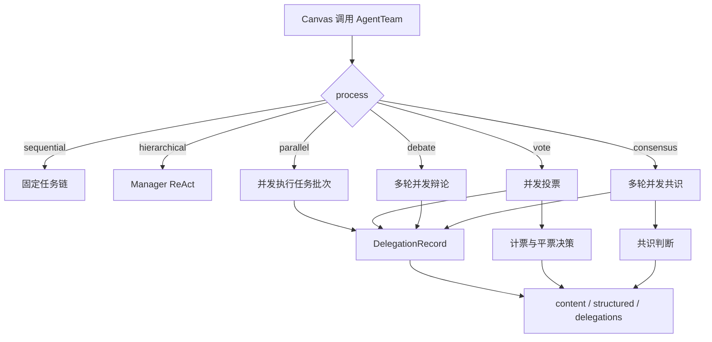

# AgentTeam 并行、投票、辩论与共识策略设计

## 1. 目标

在现有 Python Canvas 的 `AgentTeam` 组件和 `DelegateTask` 委派链路上增加四种协作策略：

- `parallel`：多个 Worker 并行执行独立任务，允许部分失败。
- `vote`：多个 Worker 独立投票，按票数和置信度选优，可选用 Judge 打破平局。
- `debate`：多个 Worker 多轮并行讨论，每轮读取其他参与者上一轮观点。
- `consensus`：多个 Worker 多轮表达立场，立场一致时提前结束，否则由 Judge 裁决或降级为投票。

本设计扩展现有实现，不创建第二套 Agent 运行时。所有策略继续复用：

- `WorkerRegistry` 的 Worker 白名单和能力解析。
- `DelegationBudget` 的团队级委派预算。
- `delegation_scope()` 的嵌套委派深度控制。
- `asyncio.wait_for()` 的单 Worker 超时。
- `DelegationRecord` 的审计输出。
- 当前 Canvas 的模型解析、日志、取消、租户和请求头基础设施。

## 2. 非目标

- 不增加前端画布节点、配置面板或 DSL 可视化编辑器。
- 不实现跨会话的团队状态、持久化投票或长期 Worker 记忆。
- 不允许 LLM 创建未注册的 Worker。
- 不替换 RAGFlow 现有的静态多 Agent 画布编排。
- 不为新策略引入独立 Manager；这些策略由配置中的任务列表驱动。
- 不实现按任务自动重试、跳过或人工审批队列。
- 不改变 Hierarchical 的现有 ReAct 委派语义。

## 3. 现有执行链

当前 `AgentTeam.process` 支持：

- `sequential`：无需 Manager，按 `tasks` 顺序执行。
- `hierarchical`：创建 Manager，并在 Manager 的 ReAct 循环中注入 `DelegateTask`。

两种策略共享 Worker 注册、预算、深度、超时和审计记录。新增策略沿用同一组件生命周期，通过 `AgentTeam._invoke_async()` 分派到策略执行器。

## 4. 配置契约

`AgentTeamParam` 增加以下字段：

| 字段 | 类型 | 默认值 | 适用策略 | 说明 |
| --- | --- | --- | --- | --- |
| `process` | string | `hierarchical` | 全部 | 团队成员执行策略 |
| `tasks` | list | `[]` | `sequential`、`parallel`、`vote`、`debate`、`consensus` | 显式任务或参与者任务 |
| `max_concurrency` | int | `4` | `parallel`、`vote`、`debate`、`consensus` | 单轮最大并发 Worker 数 |
| `collaboration_rounds` | int | `3` | `debate`、`consensus` | 最大协作轮数 |
| `judge` | string | `""` | `vote`、`debate`、`consensus` | 可选的 Judge Worker 选择器 |
| `max_delegations` | int | `8` | 全部 | 团队级 Worker 和 Judge 调用总预算 |
| `max_depth` | int | `3` | 全部 | 嵌套委派最大深度 |
| `worker_timeout` | number | `300` | 全部 | 单次 Worker 或 Judge 调用超时秒数 |

`max_concurrency` 必须是大于等于 `1` 的整数。`collaboration_rounds` 必须是大于等于 `1` 的整数。`judge` 非空时必须能由同一个 `WorkerRegistry` 唯一解析。

每个任务对象包含：

```json
{
  "worker": "reviewer_a",
  "task": "评审候选方案",
  "context": "可选上下文",
  "expected_output": "返回 choice、confidence、rationale"
}
```

约束：

- `worker`、`task`、`expected_output` 必须是非空字符串。
- `context` 可省略。
- `worker` 使用现有规则按 ID、名称、角色或唯一 capability 解析。
- `tasks` 必须是非空数组。
- `manager` 只允许用于 `hierarchical`。
- `tasks` 不允许用于 `hierarchical`。
- `sequential`、`parallel`、`vote`、`debate`、`consensus` 不允许配置 `manager`。

默认 `process` 保持 `hierarchical`，避免改变现有 DSL 的行为。

## 5. 委派预算

所有 Worker 调用和 Judge 调用都消耗一次 `DelegationBudget`。超时、异常、空输出和无效投票仍然计入预算，因为对应的模型或工具已经执行。

设任务数为 `N`，协作轮数为 `R`，Judge 存在时为 `J = 1`，否则为 `J = 0`。

| 策略 | 最坏调用次数 | 配置校验公式 |
| --- | ---: | --- |
| `sequential` | `N` | `max_delegations >= N` |
| `parallel` | `N` | `max_delegations >= N` |
| `vote` | `N + J` | `max_delegations >= N + J` |
| `debate` | `N * R + J` | `max_delegations >= N * R + J` |
| `consensus` | `N * R + J` | `max_delegations >= N * R + J` |
| `hierarchical` | 由 Manager 运行时决定 | 使用现有运行时预算检查 |

配置校验必须按最坏情况预留预算。运行时仍然逐次调用 `claim()`，因此即使出现未预期的额外调用，也会被阻止并记录为错误。

预算只在一次 `AgentTeam` 执行内有效。`reset()` 会清空预算、审计记录和运行时 Agent。

## 6. 并发、超时与深度

并行执行使用 `asyncio.gather()` 和 `asyncio.Semaphore(max_concurrency)`：

- 并发上限作用于每一轮或每一批任务，不跨轮累计。
- 每个 Worker 调用独立使用 `asyncio.wait_for(..., timeout=worker_timeout)`。
- 一个 Worker 超时或失败不会取消同一轮的其他 Worker。
- Canvas 取消沿用现有组件取消行为。
- 每个 Worker 和 Judge 调用都包在独立的 `delegation_scope(max_depth)` 中。
- `gather()` 使用返回异常的模式，避免单个任务失败终止整批执行。

`max_delegations`、`max_depth` 和 `worker_timeout` 是运行时硬限制，不依赖提示词约束。

## 7. 结果与失败语义

### 7.1 通用审计

每次 Worker 或 Judge 调用生成一条 `DelegationRecord`。记录的 `metadata` 包含：

```json
{
  "process": "vote",
  "round": 1,
  "task_index": 0,
  "role": "participant"
}
```

Judge 调用使用 `role: "judge"`。Worker 失败记录 `status: "error"` 和错误文本；成功记录 `status: "ok"` 和完整结果。

单条调用失败不会删除已有审计记录。策略输出必须同时保留成功和失败的任务结果。

### 7.2 投票响应格式

`vote` 和 `consensus` 的参与者必须返回一个 JSON 对象：

```json
{
  "choice": "approve",
  "confidence": 0.82,
  "rationale": "方案满足约束，但需要补充回滚计划。"
}
```

解析规则：

- 去除首尾空白。
- 支持直接 JSON 对象、Markdown fenced JSON，以及正文中的第一个完整 JSON 对象。
- `choice` 必须是非空字符串。
- `choice` 去除首尾空白后参与精确字符串比较，不合并大小写或同义词。
- `confidence` 可省略，省略时按 `0` 处理。
- `confidence` 必须是非负有限数值；不设置上限，便于不同模型使用不同量纲。
- `rationale` 可省略，按空字符串处理。
- 解析失败、缺少 `choice` 或 `confidence` 非法时，该响应记录为无效投票，不进入计票。

无效投票仍保留在 `rounds`、`votes` 和 `delegations` 中，并带有错误原因。

### 7.3 Judge 响应格式

Judge 必须返回：

```json
{
  "choice": "approve",
  "rationale": "在两个平票方案中，该方案风险更低。"
}
```

Vote 的候选集合是票数和置信度和都最高的平票候选。Consensus 的候选集合是最后一轮所有有效投票的 choice。Judge 也可以返回仅包含候选选择的纯文本；解析后必须精确匹配对应候选集合中的 choice。Judge 响应无效或失败时不产生伪造的 winner。

Debate 的 Judge 是总结者，不参与 winner 裁决，返回自由文本汇总。Debate 的 winner 始终为 null。

### 7.4 单任务失败

- `parallel`：失败任务留在结果列表中，其他任务继续执行，整体标记为 `partial`。
- `vote`：失败或无效投票不参与计票，其他参与者继续。
- `debate`：失败参与者不参与下一轮观点注入，但仍保留审计记录；其他参与者继续后续轮次。
- `consensus`：失败或无效投票使该轮无法达成全体共识，但其他参与者继续后续轮次。

如果一批任务全部失败，策略仍写入 `delegations`，并在 `content` 和 `_ERROR` 中给出可诊断结果。无法形成任何有效结果时，`winner` 为 `null`，不得选择失败 Worker 的文本作为答案。

## 8. 策略语义

### 8.1 Parallel

执行方式：

1. 解析全部任务。
2. 使用 `max_concurrency` 并发执行。
3. 每个任务使用现有上下文构造器，注入原始请求、运行时上下文和任务上下文。
4. 等待全部协程结束。

`content` 和 `structured` 使用同一对象：

```json
{
  "process": "parallel",
  "status": "ok",
  "results": [
    {
      "task_index": 0,
      "worker_id": "researcher_a",
      "status": "ok",
      "result": "...",
      "error": ""
    }
  ]
}
```

任一条任务失败时 `status` 为 `partial`。全部成功时为 `ok`。全部失败时 `status` 为 `error`，同时写入 `_ERROR`。

`winner` 为 `null`，`votes` 为空列表，`rounds` 只有一轮汇总，`consensus` 为 `false`。

### 8.2 Vote

执行方式：

1. 并发执行全部投票任务。
2. 解析每一份投票。
3. 按 `choice` 统计有效票数。
4. 票数最高者获胜。
5. 票数相同时，比较该 `choice` 的 `confidence` 总和。
6. 仍相同时，若配置 Judge，则让 Judge 只在最高票且最高置信度和的候选集合中选择。
7. 没有 Judge 或 Judge 无法有效裁决时，`winner` 为 `null`。

`votes` 的每一项包含：

```json
{
  "task_index": 0,
  "worker_id": "reviewer_a",
  "choice": "approve",
  "confidence": 0.82,
  "rationale": "...",
  "status": "valid"
}
```

无效投票使用 `status: "invalid"`，`error` 写明原因，`choice` 为空字符串。`rounds` 包含一轮投票结果。

`content` 和 `structured` 使用：

```json
{
  "process": "vote",
  "winner": "approve",
  "votes": [],
  "tie_break": "count",
  "judge_result": ""
}
```

`tie_break` 取值仅为 `count`、`confidence`、`judge` 或 `none`。Judge 文本写入 `judge_result`。

### 8.3 Debate

执行方式：

1. 第 1 轮并发执行全部任务，不注入其他参与者观点。
2. 后续每轮并发执行，任务上下文包含上一轮其他成功参与者的观点。
3. 每轮观点按任务配置顺序排列，便于稳定审计。
4. 完成 `collaboration_rounds` 轮后，若配置 Judge，则由 Judge 汇总；否则使用最后一轮成功观点作为团队结果。

Debate 的观点允许自由文本。Judge 只负责汇总讨论，不要求返回 choice。Debate 不以全员一致为完成条件。

`rounds` 的每一项包含：

```json
{
  "round": 1,
  "responses": [
    {
      "task_index": 0,
      "worker_id": "reviewer_a",
      "status": "ok",
      "content": "...",
      "error": ""
    }
  ]
}
```

`content` 和 `structured` 使用：

```json
{
  "process": "debate",
  "winner": null,
  "summary": "Judge 汇总或最后一轮观点汇总",
  "rounds": []
}
```

Judge 失败时 `summary` 回退为最后一轮成功观点的结构化拼接。没有 Judge 时 `summary` 也为最后一轮成功观点的结构化拼接。两种情况下 `winner` 都为 `null`。

`votes` 为空列表，`consensus` 为 `false`。

### 8.4 Consensus

执行方式：

1. 每轮并发执行全部任务，要求参与者返回投票 JSON。
2. 仅当本轮至少有一份有效投票，且所有参与者都返回有效投票并选择同一个 `choice` 时，达成共识。
3. 达成共识时立即停止，`consensus=true`，`winner` 为该 choice。
4. 未达成共识且还有轮次时，将上一轮所有有效观点注入下一轮。
5. 达到 `collaboration_rounds` 后，若配置 Judge，则让 Judge 在最后一轮有效 choice 集合中裁决。
6. 没有 Judge 时，降级为对最后一轮有效投票使用 Vote 的计数和置信度规则。
7. Judge 或降级投票仍无法产生唯一 winner 时，`winner` 为 `null`，但仍返回最后一轮票数。

`content` 和 `structured` 使用：

```json
{
  "process": "consensus",
  "consensus": false,
  "winner": "approve",
  "votes": [],
  "rounds": [],
  "resolution": "judge",
  "judge_result": ""
}
```

`resolution` 取值为 `consensus`、`vote`、`judge` 或 `none`。

## 9. 上下文构造

所有策略复用统一上下文块，不依赖字符串名称隐式注入：

- `ORIGINAL REQUEST`：调用方传入的 `user_prompt`。
- `RUNTIME CONTEXT`：调用方传入的 `context`。
- `TASK CONTEXT`：任务自身的 `context`。
- `PRIOR TASK OUTPUT`：Sequential 的前一步结果。
- `PREVIOUS ROUND`：Debate 和 Consensus 的上一轮其他参与者观点。
- `EXPECTED OUTPUT`：任务自身的验收条件。

多轮上下文只注入成功且有内容的响应。失败记录不会作为事实输入下一轮。参与者自己的上一轮观点不在 `PREVIOUS ROUND` 中重复，但其原始任务约束会继续保留。

## 10. 代码边界

### 10.1 `agent/delegation.py`

职责：

- 增加 `PARALLEL_PROCESS`、`VOTE_PROCESS`、`DEBATE_PROCESS`、`CONSENSUS_PROCESS` 常量。
- 扩展 `AGENT_TEAM_PROCESSES`。
- 将固定任务描述泛化为团队任务描述，供 Sequential 和新策略共用。
- 增加投票、Judge、轮次响应和共识结果的数据模型。
- 保持预算、深度和审计记录为唯一运行时控制面。

### 10.2 `agent/collaboration.py`

新增纯逻辑模块，职责仅包括：

- 解析投票 JSON 和 Judge JSON。
- 构建上一轮观点上下文。
- 计票、置信度和平票候选计算。
- Vote 和 Consensus 的 winner 决策。
- Debate 和 Consensus 轮次结果的稳定序列化。

该模块不创建 Agent、不访问 Canvas、不执行 I/O。

### 10.3 `agent/component/agent_team.py`

职责：

- 扩展参数校验和新 `process` 分派。
- 实现基于 `asyncio.Semaphore` 和 `asyncio.gather()` 的批量执行器。
- 在统一的 Worker 调用入口中应用预算、深度、超时和审计。
- 实现 Parallel、Vote、Debate、Consensus 的轮次编排。
- 写入 `content`、`structured`、`votes`、`rounds`、`consensus`、`winner`、`delegations` 和 `_ERROR`。

不得把投票解析、计票和共识判断继续堆入组件文件。

### 10.4 `docs/develop/agent_team_delegation_zh.md`

更新为六种策略的完整使用文档，删除“当前不支持并行、投票、辩论和共识”的过期说明，并增加配置示例、输出契约、成本公式和失败行为。

## 11. 数据流



每次调用都经过同一入口：

```text
resolve worker
  -> claim budget
  -> enter delegation scope
  -> run worker with timeout
  -> require non-empty content
  -> append DelegationRecord
```

## 12. 验证场景

实现验证至少覆盖以下行为：

- Parallel 的实际并发数不超过 `max_concurrency`，部分失败不取消其他任务。
- Vote 按票数、置信度和 Judge 的顺序处理平票。
- 无效投票、空内容和 Worker 异常不会进入计票。
- Debate 的后续轮次包含其他参与者上一轮观点，不包含失败响应。
- Consensus 在全员一致时提前结束，不消耗剩余轮次预算。
- Consensus 无共识时按 Judge 或 Vote 降级。
- `max_delegations` 对每个策略的最坏情况校验生效，运行时超限产生审计错误。
- 单次 Worker 超时不会取消同批其他 Worker。
- 嵌套委派深度并发时仍由 `ContextVar` 隔离。
- 所有策略都写入 `delegations`，并稳定输出 `votes`、`rounds`、`consensus` 和 `winner`。
- 默认 `process` 仍为 `hierarchical`，现有 Sequential 和 Hierarchical 行为不回归。

## 13. 验收标准

- `AgentTeam.process` 接受 `parallel`、`vote`、`debate`、`consensus` 四个新值。
- 四个新策略均不依赖 Manager。
- 所有 Worker 和 Judge 调用均受预算、深度和超时限制。
- 部分失败不会让 Parallel 丢失其他成功结果。
- Vote 和 Consensus 不把无效 JSON 当作有效选票。
- Debate 和 Consensus 的轮次数据可按顺序审计。
- `content` 是稳定的 JSON 字符串，`structured` 是对应的 Python 对象。
- 文档不再声明新策略缺失。
- 不修改无关组件，也不引入第二套 Agent 执行器。
